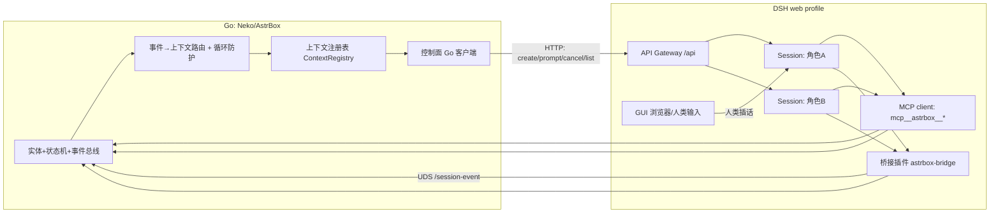

# DSH × Neko 多角色上下文驱动 · 落地规划

- 状态：规划草案 v1（2026-11-01）
- 仓库：`/home/ruicat/Desktop/Neko`（AstrBox / Neko）
- 上游：`/home/ruicat/Desktop/deepseek-harness`（DSH checkout，文档与源码均以此为准）
- 第一轮交付形态：只出规划文档 + 接口契约草案；后续按用户要求进入实现（见 `01-implementation.md`）
- 主线选择（用户已定）：DSH 作为与 AI 通信层，Neko 作为调用/驱动层；拓扑 A（web profile 内挂桥接），控制面用 HTTP 协议
- P1 核心已实现（2026-11-01）：见 `runs/dsh-neko-contexts/01-implementation.md`；P0 真实 DSH 探针仍未跑（缺启动 token）

## 0 结论摘要

1. 方向可行。DSH 确实有「现成的 HTTP 会话控制」：API Gateway 把会话操作暴露成 `session/create`、`session/prompt`、`session/cancel`、`session/list` 等 Remote 方法，走 `POST /api/<endpoint>`（`packages/api/session-controller/src/index.ts:275,300,461,513`）。
2. 但它不是给常驻外部进程设计的自动化 API：鉴权是「进程启动 token → `GET /connect` 换签名 Cookie」，token 每进程随机、Cookie 绑定进程内 Peer，DSH 重启即失效（`packages/client/connection/README.md:41,51`）。因此部署形态必须是 **Neko 监管 DSH 进程并解析启动行**，或人工把带 token 的 URL 交给 Neko。
3. 角色上下文 = **DSH Session + 角色 preset**：人设由 `@deepseek-ai/dsh-persona` 挂在 preset 里（`packages/preset/persona/README.md`），Neko 用稳定 sessionId 复用同一会话，自带重启续接。
4. 三个面分工清楚才不打架：**控制面** Neko→DSH（HTTP）；**观测面** DSH→Neko（现有桥接 `/session-event`，需扩 payload）；**反向面** DSH→Neko（现有 MCP 17 工具，但当前**无会话归属**）。
5. 多上下文互发由 Neko 路由：A 角色会话内模型调工具 → Neko 校验 → 投递到 B 会话。必须配 hop 上限、去重、冷却，否则两个角色会自激。
6. 先做 P0 五个探针（S1–S5，§6）再谈实现；探针有一条不过，对应契约就改，不进实现期。

## 1 定级与范围

**定级：L2（单域深做，交付物 = 规划文档 + 契约草案）。**
依据：只产出一份文档，无并行执行体、无写域冲突、不写源码；接口只出草案，冻结放到 P0 探针之后（届时按 L3 走 `task-planning`）。

**本轮明确不做：**

- 不改 `internal/` 任何 Go 源码，不改 `dsh/lib/*.mjs`，不改 `~/.dsh` profile。
- 不实现 Go 侧 HTTP 客户端、不实现插件侧事件扩展、不写 `neko_*` 工具。
- 不冻结契约：§5 全部是草案，探针结果会改它。
- 不建常驻服务、不申请提权、不读写 `~/.dsh/.credentials.yaml`。

## 2 现状核对

### 2.1 Neko 侧（已存在的积木）

| # | 能力 | 现状 | 锚点 |
|---|---|---|---|
| 1 | DSH 桥接插件 | 只做四件事：静态提示段、每轮状态快照、定时 tick、两类会话事件上报 | `dsh/lib/plugin.mjs:4-8` |
| 2 | 会话事件 | 仅 `session-created` 与 `turn-end`；`turn-end` 只带 `sessionId/cwd/turn` | `dsh/lib/sessionEvents.mjs:72-102`、`internal/control/sessionEvent.go:11-27` |
| 3 | 控制面 | Unix socket，四条路由：`/health /state /tick /session-event` | `internal/control/router.go:8-27` |
| 4 | 反向工具 | MCP 17 个 `mcp__astrbox__*` 工具 | `docs/mcp-tools.md:3` |
| 5 | 插件安装状态 | **未安装**：web profile 的 `dsh.profile.bundles` 没有 `dsh-astrbox` | `~/.dsh/profiles/web/package.json` 的 bundles 列表 |
| 6 | 会话快照实体 | 插件配置只有一个 `entity`（默认 `猫猫`），多角色时会话会拿到同一个实体的快照 | `dsh/cordis.patch.yml:29-43`、`docs/dsh-plugin.md:54-68` |

### 2.2 DSH 侧（可复用的现成实现）

| # | 能力 | 契约 | 锚点 |
|---|---|---|---|
| 1 | 建会话 | `session/create`：`{cwd?, workspaceId?, sessionId?, agentPreset?}` → `{sessionId, agentPreset?}`；命名会话可复用/续接 | `packages/api/session-controller/src/index.ts:300`、`packages/api/session-controller/src/types.ts:288-305` |
| 2 | 投递消息 | `session/prompt`：`{requestId, sessionId, mode: 'queue'\|'steer', content[], clientTimeZone?}` → `{accepted:true}`；**不返回 messageId** | `packages/api/session-controller/src/index.ts:461`、`packages/api/session-controller/src/types.ts:344-357` |
| 3 | 取消 | `session/cancel`：`{sessionId}` → `{accepted:true}`；取消活动轮但保留待处理 inbox | `packages/api/session-controller/src/index.ts:513`、`packages/api/session-controller/src/types.ts:384-391` |
| 4 | 会话列表 | `session/list`：每行有 `running`、`agentAvailable`、`blank` | `packages/api/session-controller/src/index.ts:275`、`packages/api/session-controller/src/types.ts:178-191` |
| 5 | 角色人设 | preset 内挂 `@deepseek-ai/dsh-persona`（`prefix/suffix/complete/includeRuntimeContext`），会话按 preset 启动 | `packages/preset/persona/README.md`、`packages/preset/agent-preset/README.md` |
| 6 | 进程内建会话范式 | `ctx.agents.create({sessionId, meta, setup})` + `permissionPresets.set` + `followup`（webhook 已用） | `packages/experimental/webhook/src/session.ts:134-153` |
| 7 | steer 语义 | 空闲时 steer 会起一轮；运行中在最近 step 边界插入 | `packages/core/agent/src/runtime-types.ts:225-241` |
| 8 | 启动 token | `dsh web` 启动行打印 `dsh web: <url>?token=<launchToken>` | `packages/bundle/web-app/src/index.ts:219-232` |
| 9 | API 接入 | `GET /connect?token=…&interactions=none` → 302 + 签名 API Cookie；之后 `POST /api/...` | `packages/client/connection/README.md:51`、`packages/client/connection/src/browser-auth.ts:314-352` |
| 10 | 请求封套 | 请求体 `{type:'client-request', rpcId, method, payload}`；响应 `{type:'server-response', rpcId, result}` | `packages/client/connection/src/rpc.ts:80-96`、`packages/client/connection/src/rpc-schema.ts:33-38`、`packages/client/connection/src/rpc-host.ts:312-345` |
| 11 | 工具执行上下文 | `ToolExecution.agent` 带调用方 Agent（工具包装可拿到会话身份） | `docs/subsystems/tools.md:180,207` |
| 12 | MCP 工具调用 | 只传参数，不携带会话/Agent 归属 | `packages/mcp/mcp-client/src/tools.ts:138` |

### 2.3 本次实测（只读探针）

```text
GET  /                      -> 401   （未认证，浏览器信任栅栏生效）
POST /api/session/list      -> 401   （无 Cookie）
POST /api/session/list      -> 403   （伪造 Host: evil.example，Host 校验生效）
```

结论：HTTP 面确实在监听，且**必须有 Cookie + 合法 Host** 才能进；不是「本地无鉴权」。

### 2.4 缺口（本规划要解决的）

| 缺口 | 现状 | 影响 |
|---|---|---|
| G1 会话打开/驱动 | Neko 没有任何「建会话 / 投消息」能力 | 无法实现「Neko 驱动」 |
| G2 结果回传 | 只有 `turn-end`，没有助手文本/工具摘要 | Neko 状态机只能知道「轮结束」，不知道「说了什么」 |
| G3 多角色快照 | 插件单一 `entity` | B 角色的会话会读到 A 角色的状态 |
| G4 反向归属 | MCP 调用无 sessionId | 多角色时无法判定「谁在写状态」 |
| G5 跨上下文投递 | 无 | 角色间互发无从谈起 |
| G6 会话关闭 | 无 close/delete API | 只能本地标记 inactive |

## 3 目标架构

### 3.1 分层



- **控制面**：Neko → `POST /api/session/{create,prompt,cancel,list}`。无新增 DSH 代码。
- **观测面**：桥接插件 → Neko 的 UDS `POST /session-event`（扩展 payload）。事件至少一次、按 `(kind, sessionId, turn)` 去重。
- **反向面**：会话内工具调用 → Neko。V1 沿用 MCP 17 工具；多角色归属见 §4-D4。
- **人类输入**：GUI 里对同一 Session 打字，DSH 原生处理（queue 或 steer），Neko 通过事件看到轮边界。

### 3.2 三个面各自的契约主体

| 面 | 谁拥有契约 | 谁实现 | 失败时谁负责 |
|---|---|---|---|
| 控制面 | DSH（现有 Remote 方法） | Neko 侧 Go 客户端 | Neko 重试/降级/告警 |
| 观测面 | Neko（`/session-event` 请求体） | DSH 桥接插件 | 插件 fire-and-forget，Neko 用轮询兜底 |
| 反向面 | Neko（MCP 工具 schema） | DSH MCP client + Neko MCP server | 工具失败在会话内暴露给模型 |

### 3.3 单轮时序（一次事件驱动）

```text
Neko 事件 E ──▶ 路由选目标 contextId ──▶ session/create?（未开则开）
                                   └──▶ session/prompt(mode=queue|steer, requestId=neko:<ctx>:<E>)
DSH 起 turn ──▶ agent/pre-step 注入 [astrbox] 快照（插件）
           ──▶ 模型调用 mcp__astrbox__*（状态读写/事件回调）
           ──▶ 模型可能调用 neko_context_send(target, text)（跨上下文）
turn 结束 ──▶ 插件 POST /session-event {kind:turn-end, sessionId, turn, summary}
Neko ──▶ 更新状态机 / 记账 / 触发下一事件 / 发送跨上下文投递
```

### 3.4 上下文生命周期

```text
closed ──open()──▶ idle ──prompt──▶ running ──turn-end──▶ idle
                    ▲                  │
                    └────cancel───────┘
```

- `open` 用稳定 `sessionId`（`neko-<character>`），DSH 复用/续接已有会话。
- `close` 没有 API：本地标记 `closed` + 若在运行则 `cancel`；会话本身留在 DSH，GUI 仍可见。

## 4 裁决点（需拍板；正文按推荐值写）

### D1 控制面用哪条 HTTP

| 选项 | 含义 | 代价 | 结论 |
|---|---|---|---|
| **A（推荐）** | 直接用现有 API Gateway：`/connect` 换 Cookie + `/api/session/*` | 零 DSH 新增代码；但 token 每进程、契约非公开、无 messageId、无 close | 推荐 |
| B | 桥接插件用 `ctx.webServer.register` 挂自己的 `/neko/*` 路由，内部调 `ctx.sessionController` | 控制面稳定、可自定鉴权；但要写插件代码，且多一套契约 | 备选 |
| C | 双实现（Go 侧 Driver 接口，A/B 各一后端） | 最稳；工作量最大 | 后置 |

**选 A 的推翻条件**：① Neko 不允许监管 DSH 进程（拿不到 token）；② DSH 升级后 `/api` 契约变化导致会话控制失败。命中任一条就切 B。

### D2 部署形态（token 从哪来）

| 选项 | 含义 | 代价 | 结论 |
|---|---|---|---|
| **A（推荐）** | Neko 监管 DSH：spawn `dsh web --no-open`，读 stdout 的 `dsh web: <url>?token=…`，负责重启与重新 `/connect` | 需要 Neko 有子进程管理；DSH 崩溃要自动拉起 | 推荐 |
| B | 人工授予：用户把带 token 的 URL 填进 Neko 配置 | 每次 DSH 重启都要手动更新，不适合常驻 | 仅调试用 |
| C | 无头 SDK：Neko spawn `dsh --profile sdk` 走 JSON-RPC | 绕开 token，但**没有 GUI、没人能插话**，与「会话接受其他输入」冲突 | 不做 |

### D3 角色人设绑在哪

| 选项 | 含义 | 代价 | 结论 |
|---|---|---|---|
| **A（推荐 v1）** | 每角色一个 preset，preset 内挂 `dsh-persona` | 与 profile 现有 4 个 preset 同机制；加角色要改 profile（重启或 reload 未验证） | 推荐 |
| B | 插件注册动态提示段：按 `AssembleContext.agent` 查角色卡 | 角色是纯数据、免改 profile；但要写代码，且 `complete`/order 需谨慎 | P3 备选 |
| C | 首条 user prompt 里写人设 | 零配置；但人设进历史、KV 不共享、易被后续消息稀释 | 只在探针期用 |

### D4 反向工具怎么带会话归属

| 选项 | 含义 | 代价 | 结论 |
|---|---|---|---|
| **A（v1）** | 维持 MCP 17 工具 | 零改动；**无归属**，只适合单角色或全局串行 | 过渡 |
| **B（推荐 P3）** | 桥接注册原生 `neko_*` 工具，从 `exec.agent` 取 sessionId 再转发 Neko | 归属可靠；要写插件侧工具注册 | 推荐 |
| C | `tools/execute` 包装 MCP 调用，旁路把归属投给 Neko | 不动工具面；但旁路对账复杂、易错 | 不推荐 |

### D5 结果事件怎么回来

| 选项 | 含义 | 代价 | 结论 |
|---|---|---|---|
| **A（推荐）** | 扩展现有桥接：`turn-end` 带助手文本摘要/工具摘要，可选 `user-message` | 新通道零成本；要改插件代码 | 推荐 |
| B | Go 侧实现 `/api/remote.mux` 的 `session/follow` 流 | 全量事件、不依赖插件；实现成本高 | P3 可选 |
| C | 轮询 `session/list` + 读会话日志 | 最省代码；最脆（格式/写者/时序） | 只做兜底 |

## 5 接口契约草案（C0–C8）

> 原则：每条写「形态 + 违反后果 + 验收」，探针结果会修正它；**文档里不冻结**。

### C0 上下文记录（Neko 本地，持久化到 `data/contexts.json`）

```json
{
  "contextId": "ctx-catcat",
  "characterId": "猫猫",
  "sessionId": "neko-catcat",
  "presetId": "neko-catcat",
  "cwd": "/home/ruicat/Desktop/Neko",
  "status": "idle",
  "lastTurn": 12,
  "openedAt": "2026-11-01T21:00:00+08:00",
  "updatedAt": "2026-11-01T21:30:00+08:00"
}
```

- 硬约束：`sessionId` 是**稳定身份**，跨 Neko 重启不变；`sessionId → characterId` 是唯一映射。
- 违反后果：多角色快照/反向归属都会串号。
- 验收：重启 Neko 后按 `sessionId` 复开会话，DSH 返回同一 id（`session/create` 复用语义）。

### C1 打开 / 复用

```text
POST /api/session/create
payload: { "cwd": "<context.cwd>", "agentPreset": "<presetId>", "sessionId": "<sessionId>" }
value:   { "sessionId": "<实际id>", "agentPreset": "<presetId>" }
```

- **只认返回值**：DSH 可能因目录冲突/被别的写者持有而返回新 id，Neko 必须把返回值写回注册表并告警。
- 冲突错误码：`session/conflict`、`session/agent-busy`、`session/writer-held`（`packages/api/session-controller/src/types.ts:210-217`）。
- 禁止：假设请求 id 一定被采纳。
- **2026-11-01 实测修正**：`session/create` 对**已开始**的命名会话会**新建**一个会话（返回新 id），不能当续接用；
  续接 = 直接 `session/prompt` 到已存的 id。Neko 只在上下文还没有 `sessionId` 时 create。
- Remote 封套实测：`payload` 必须是 `{"args":{"request":…}}`（`session/list` 用 `_request`），否则 `gateway/arguments-invalid`。

### C2 投递（事件 → 会话）

```text
POST /api/session/prompt
payload: {
  "requestId": "neko:<contextId>:<eventId>",
  "sessionId": "<sessionId>",
  "mode": "queue" | "steer",
  "content": [{ "type": "text", "text": "<envelope>" }],
  "clientTimeZone": "Asia/Shanghai"
}
value: { "accepted": true }
```

**mode 选择表（草案）**

| 会话状态 | 事件优先级 | mode | 说明 |
|---|---|---|---|
| idle | 任意 | `queue` | 直接起一轮 |
| running | normal | `queue` | 排队，等本轮结束 |
| running | urgent | `steer` | 在最近 step 边界插入 |
| running | preempt | `cancel` → `queue` | 仅显式策略允许；取消会保留 inbox |

**envelope 格式（冻结候选）**

```text
【neko 事件】source=<characterId|tick|schedule|context:xx> kind=<eventKind> event=<eventId> ts=<RFC3339>
<正文：事件引起的可读描述>
```

- `requestId` 是幂等键：DSH 对已排队/已落日志的 `requestId` 返回原受理、不重复插入（`session-controller` 的 prompt 文档段）。
- 硬约束：**同一条事件只允许一个 `requestId`**；重试复用同一个。
- 已知限制：`session/prompt` 只回 `{accepted:true}`，**没有 messageId**，所以「消息 → 轮」对账只能靠 `turn-end` 与日志，不能靠返回值。

### C3 事件回传（插件 → Neko，现有 `/session-event`）

```json
{
  "kind": "turn-end",
  "sessionId": "neko-catcat",
  "cwd": "/home/ruicat/Desktop/Neko",
  "turn": 12,
  "summary": { "assistantDigest": "…", "toolCalls": 3, "usage": {} },
  "function": "dsh_on_event"
}
```

- 现有两种 kind（`session-created` / `turn-end`）保持不变，新增字段向后兼容（`summary` 可缺省）。
- 新增可选 kind：`user-message`（人类在 GUI 插话，Neko 需要感知时启用）。
- 语义：**至少一次**；Neko 按 `(kind, sessionId, turn)` 去重（与插件去重表口径一致，`dsh/lib/sessionEvents.mjs:9`）。
- 验收：同一轮重复投递两次，Neko 只记一次状态迁移。

### C4 反向工具契约（会话内 → Neko）

- V1：沿用 MCP 17 工具；schema 与返回值不变（`docs/mcp-tools.md`）。
- 新增（P2 起草、P3 冻结）：

```text
neko_context_send
  targetContextId: string   目标上下文（注册表里的 contextId）
  text: string              要投递的正文
  priority: "normal" | "urgent"
  -> { accepted: boolean, messageId?: string }
```

- 归属：P3 由桥接原生工具从 `exec.agent.session.id` 取来源（`docs/subsystems/tools.md:207`）；MCP 路径不接受「来源」参数——模型自报的来源不可信。
- 循环防护：Neko 侧对 `(fromCtx, toCtx, hash(text))` 去重窗口 60s，`hop ≥ 3` 拒绝并回告。

### C5 路由与循环防护（Neko 内部）

| 规则 | 判据 | 违反后果 | 落地 |
|---|---|---|---|
| 单上下文串行 | 同一 `contextId` 同时最多一个在飞 prompt | 交错历史、状态互相踩 | Neko per-context 队列 |
| 跨上下文并行 | 不同 `contextId` 可并行 | —— | 全局 worker 池，上限可配 |
| hop 上限 | `hop ≤ 3`（消息携带 hop） | 两个角色互相回话会自激 | envelope 里带 `hop` |
| 去重 | `(from,to,hash)` 60s 窗口 | 重复消息刷轮 | 内存 LRU |
| 配额 | 每 context 每分钟调用 ≤ N | 模型刷屏 | 计数器 + 冷却 |

### C6 鉴权与连接生命周期

1. 取 token：`dsh web` 启动行 `dsh web: <url>?token=<token>`（`packages/bundle/web-app/src/index.ts:231`）。
2. `GET /connect?token=<token>&interactions=none` → 302 + `Set-Cookie`（API Cookie，owner principal）。
3. 后续请求带该 Cookie，`Host` 必须是 `127.0.0.1:3080`（loopback 或绑定地址）；**不支持 Authorization 头**。
4. Cookie 与进程内 Peer 绑定：若 Neko 建了 mux socket 又关闭，Peer 消失，Cookie 立即失效；**只用 unary 时 Peer 可存活到 Host 关闭**。
5. DSH 重启 ⇒ 重新取 token → 重新 `/connect` → 重建上下文（会话本身持久化，靠 `session/create` 续接）。

- 失败处置：401 → 刷新 token 重连一次；仍 401 则停止驱动并告警（不要反复撞）。

### C7 幂等 / 重试 / 错误码

| 错误码 | 处置 |
|---|---|
| `session/conflict` / `session/writer-held` | 不重试；新建 session 或告警 |
| `session/agent-busy` | 退避 1 次后告警 |
| `gateway/cancelled` | 视为调用方取消，不重试 |
| `remote-access/denied` | 不重试（配置问题），告警 |
| 网络/5xx | 只重试 1 次；同 `requestId` |

### C8 可观测性

- Neko 记 JSONL：`contextId, sessionId, requestId, mode, httpStatus, latency, turn, outcome`。
- 指标：调用数/失败率/轮时长/队列深度/hop 分布/token 刷新次数。
- 禁止落盘模型对话正文（沿用现有信任边界，`docs/dsh-plugin.md:161-162`）。

## 6 分期与验收闸门

### P0 探针（先做，全部只读/最小写）

| # | 探针 | 命令/动作 | 过闸证据 |
|---|---|---|---|
| S1 | 取 token + 建会话 | Neko 外的 shell：`GET /connect` → `session/create` | 返回含 `sessionId` 的 JSON；GUI 能看到该会话 |
| S2 | 投递 + 观察轮结束 | `session/prompt(mode=queue)` → `session/list` 轮询 `running` | 看到 `running: true → false` |
| S3 | 反向工具 | 会话内调 `mcp__astrbox__entity_state_get` | 工具返回真实状态；同时确认调用不带 sessionId |
| S4 | 人机并发 | 会话运行中在 GUI 打字 | 记录 GUI 输入是排队还是插话（`queue`/`steer` 实测行为） |
| S5 | 会话复用 | 同名 `sessionId` 再 `create` | 返回同一 id（或明确记录改 id 的条件） |

**不过闸门不进入 P1**；任一失败改 §5 对应契约。

### P1 单角色闭环（Neko 代码改动）

- 范围：`contexts.json` 注册表 + Go HTTP client + 事件→prompt + `turn-end`→状态机。
- 验收：一条真实 `.neko` 事件驱动一轮完整 turn，`turn-end` 回写状态，进程重启后同 `sessionId` 续接。

### P2 多上下文

- 范围：多角色 preset（profile patch）、多行注册表、`neko_context_send`、路由与循环防护、插件按会话输出对应实体快照。
- 验收：A 发消息给 B、B 回 A；10 分钟压测无自激、无串号；hop 计数正确。

### P3 归属与实时

- 范围：桥接原生 `neko_*` 工具（带 sessionId）；可选实现 mux stream 替代轮询。
- 验收：两个角色并发写状态，归属 100% 正确（抽样 100 次）。

## 7 风险与冲突

| # | 风险 | 影响 | 处置 |
|---|---|---|---|
| R1 | `/api` 是浏览器契约，不是稳定的自动化 API；无版本协商 | DSH 升级可能直接打断 Neko | P0 记录当前版本；升级前跑一遍 S1–S5 |
| R2 | token 每进程随机、Cookie 绑 Peer | DSH 重启后全断 | D2-A：Neko 监管 DSH |
| R3 | 无 `messageId`、无 close/delete | 消息级对账做不了；关会话只能本地标记 | 契约按 turn 对账；close 用 cancel+标记 |
| R4 | 跨上下文消息在 B 的会话里是 **user 角色** | 无法区分「人说的」与「A 角色说的」 | envelope 前缀 + 后续评估插件侧 `agent-message` 源 |
| R5 | MCP 调用无归属 | 多角色时状态写入来源不明 | D4-B（P3） |
| R6 | 插件单 `entity` | 多角色快照串号 | P2 增加 `sessionId → entity` 映射 |
| R7 | 人机双写者 | 轮交错、状态竞争 | per-context 串行 + `requestId` 幂等 + `turn-end` 对账 |
| R8 | 角色 preset 改动需要改 profile | 加角色要重启 | 先用静态 preset；D3-B 动态 section 作为后置 |
| R9 | steer 空闲起轮、取消保留 inbox | 语义误解会导致「以为打断实际排队」 | P0-S4 实测后写进契约 |
| R10 | 成本 | 人设 + 快照 + envelope 每轮都占 token | P1 测量每轮 token，超预算再裁剪 |

## 8 未验证假设（写成可推翻的形式）

| # | 假设 | 推翻条件 |
|---|---|---|
| A1 | `/connect` 换来的 Cookie 可只做 unary 调用（不建 mux socket） | 第二次 unary 返回 401/`gateway/peer-disposed` |
| A2 | 同名 `sessionId` + 同 `cwd` 再 create 会复用/续接 | 返回不同 id 或 `session/conflict` |
| A3 | 空闲时 `mode=steer` 会起一轮 | 返回 `accepted` 但 `running` 恒为 false |
| A4 | 桥接的 `agent/turn-stopping` payload 能读到助手文本 | `payload.agent.session` 无事件读取接口 |
| A5 | profile patch 改 preset 后 `patchReload: live` 能热生效 | 改完 `dsh --dump-config` 仍是旧值或必须重启 |
| A6 | GUI 与 Neko 可同时写同一 Session 且不互相踢 | 出现 `session/writer-held` |

## 9 证据锚点表

| 结论 | 锚点 |
|---|---|
| 现有桥接职责 | `dsh/lib/plugin.mjs:4-8` |
| 事件类型与 payload | `internal/control/sessionEvent.go:11-27`、`dsh/lib/sessionEvents.mjs:72-102` |
| 控制面路由 | `internal/control/router.go:8-27` |
| 17 个 MCP 工具 | `docs/mcp-tools.md:3` |
| 插件未安装 | `~/.dsh/profiles/web/package.json`（bundles 列表无 `dsh-astrbox`） |
| 单 entity 配置 | `dsh/cordis.patch.yml:29-43`、`docs/dsh-plugin.md:54-68` |
| 会话 create/prompt/cancel/list | `packages/api/session-controller/src/index.ts:275,300,461,513` |
| 请求/响应类型 | `packages/api/session-controller/src/types.ts:178-191,288-305,344-357,384-391` |
| token 与 /connect | `packages/client/connection/README.md:41,51`、`packages/bundle/web-app/src/index.ts:219-232` |
| 请求封套 | `packages/client/connection/src/rpc.ts:80-96`、`packages/client/connection/src/rpc-schema.ts:33-38` |
| steer 语义 | `packages/core/agent/src/runtime-types.ts:225-241` |
| 工具执行带 agent | `docs/subsystems/tools.md:180,207` |
| MCP 不带会话归属 | `packages/mcp/mcp-client/src/tools.ts:138` |
| persona 机制 | `packages/preset/persona/README.md` |
| 实测 401/403 | 本文 §2.3（命令与输出） |
